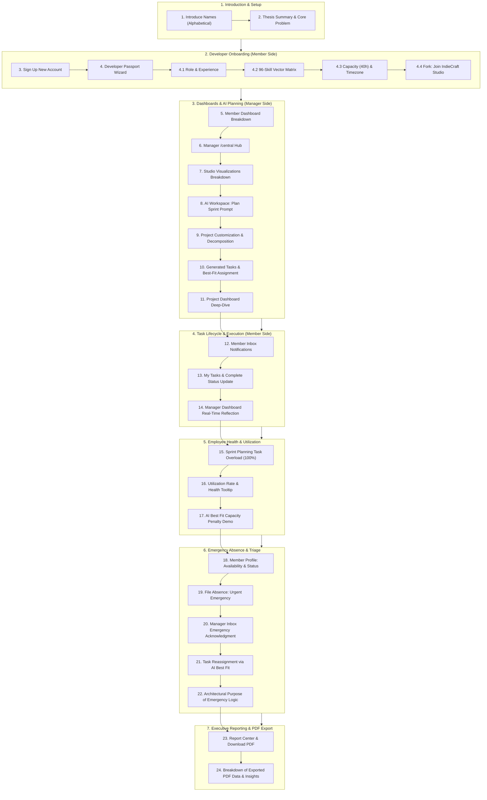

# StudioSprint — Final Thesis Defense Presentation & Reviewer Suite

Welcome to the **StudioSprint Final Thesis Defense Documentation Suite**. This directory contains the official reviewer materials, step-by-step demonstration scripts, technical deep-dives, mathematical formulas, and panel defense Q&A preparation designed for the thesis presenters.

---

## 📁 Directory Structure

| File | Document Title | Description | Target Use During Defense |
| :--- | :--- | :--- | :--- |
| **[`README.md`](file:///e:/PROGRAMMING/Thesis/Project/indie-studio-saas/docs/final_defense/README.md)** | **Defense Suite Overview** | Setup instructions, dual-browser preparation, and flow map. | 15 minutes before defense |
| **[`01_FINAL_DEFENSE_DEMO_SCRIPT.md`](file:///e:/PROGRAMMING/Thesis/Project/indie-studio-saas/docs/final_defense/01_FINAL_DEFENSE_DEMO_SCRIPT.md)** | **Step-by-Step Demonstration Script** | Complete click-by-click flow (Steps 1–24), exact spoken presenter scripts, UI breakdowns, and system under-the-hood reactions. | Live during presentation |
| **[`02_TECHNICAL_CONCEPTS_AND_FORMULAS.md`](file:///e:/PROGRAMMING/Thesis/Project/indie-studio-saas/docs/final_defense/02_TECHNICAL_CONCEPTS_AND_FORMULAS.md)** | **Technical Guide & Equations** | Deep dive into GNN, CPA/CPM, PERT, Neuro-symbolic LLM orchestration, Multi-tenancy, Bandwidth/Health formulas, and PDF architecture. | Reviewer & defense basis |
| **[`STORY_POINTS_EXPLAINED.md`](file:///e:/PROGRAMMING/Thesis/Project/indie-studio-saas/docs/final_defense/STORY_POINTS_EXPLAINED.md)** | **Story Points Plain-English Guide** | "Dumbed-down" guide for presenters: what Story Points are, pizza analogies, why not hours, AI suggestions, and CPA bridge. | Reviewer & presenter cheat sheet |
| **[`03_PANEL_DEFENSE_QA_CHEATSHEET.md`](file:///e:/PROGRAMMING/Thesis/Project/indie-studio-saas/docs/final_defense/03_PANEL_DEFENSE_QA_CHEATSHEET.md)** | **Panel Q&A & Defense Cheatsheet** | Anticipated panelist/adviser questions with authoritative, codebase-grounded answers and citations. | Open during panel Q&A |

---

## 🖥️ Pre-Defense Setup & Environment Checklist

### 1. Server Terminals (Must all be green and running)
Before opening any browser, ensure the three fundamental server services are active:
1. **Laravel Backend:** `npm run php:serve` (Runs on `http://127.0.0.1:8000`)
2. **React/Inertia Frontend:** `npm run dev` (Runs Vite HMR on `http://127.0.0.1:5173`)
3. **Python ML Engine:** `npm run ml:serve` (Runs FastAPI microservice on `http://127.0.0.1:8001`)

### 2. Dual-Browser Window Setup (Crucial Requirement)
Prepare **two distinct Chrome browser windows** (or one normal profile and one Incognito/Guest profile) arranged side-by-side or mapped to convenient `Alt + Tab` switching:

```
┌──────────────────────────────────────┐  ┌──────────────────────────────────────┐
│       WINDOW 1: STUDIO MANAGER       │  │        WINDOW 2: STUDIO MEMBER       │
│                                      │  │                                      │
│  • URL: http://localhost:8000/central│  │  • URL: http://localhost:8000/       │
│  • Account: Studio Owner / Leader    │  │  • Account: Newly Registered Member  │
│  • Role: Coordinates studio, plans   │  │  • Role: Completes tasks, logs       │
│    sprints, triages emergencies.     │  │    absences, checks personal inbox.  │
└──────────────────────────────────────┘  └──────────────────────────────────────┘
```

> [!IMPORTANT]
> **Why 2 Browsers?**
> StudioSprint utilizes path-based multi-tenancy and role-based access control (RBAC). Using two separate sessions demonstrates **real-time bi-directional synchronization**, role-gated UI permission states, and how manager-side allocations propagate directly to developer personal workstreams.

---

## ⏱️ High-Level 24-Step Demonstration Roadmap



---

## 🎯 Defense Core Principles to Emphasize

1. **Neuro-Symbolic Architecture (Separation of Concerns):**
   - The LLM **never** guesses schedules, dates, or match probabilities.
   - Deterministic algorithms (**PyTorch Geometric GNN** and **Critical Path Method**) compute exact math.
   - The LLM (**LangChain / Ollama**) parses unstructured text and synthesizes executive explanations.

2. **Human-Centric Labor Protection:**
   - The platform treats developer capacity as a finite, non-linear physical resource.
   - Overloading past contract thresholds ($>80\%$ Watchlist, $\ge 95\%$ At Risk) triggers algorithmic penalties.
   - Emergency declarations maintain data privacy—no invasive medical diagnostic records are kept, yet the critical path is immediately protected.

3. **No Silent Task Dropping (Anti-Slop Design):**
   - When developers declare an emergency, tasks remain assigned until a manager explicitly triages them. This prevents git merge collisions, dangling branch context, and unassigned backlog bloat.

4. **Multi-Tenant Data Isolation:**
   - Landlord database stores global passports, studio registry, and auth.
   - Tenant database isolates sprint backlog, task dependencies, channel messages, and reports.
